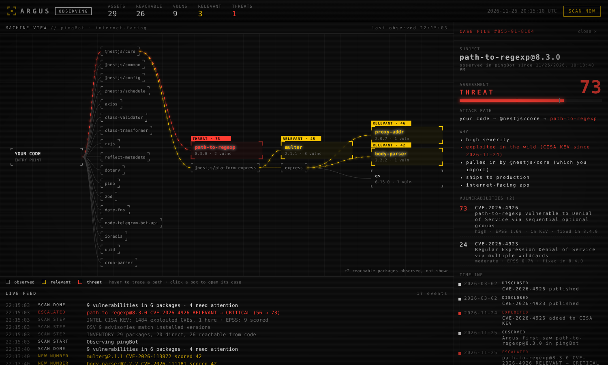

# Argus

**A machine that watches your dependencies.** Your audit tool lists 88 vulnerabilities. Argus finds the 4 that can actually reach production, draws the path from your code to each one, and tells you which one to fix first.


<sub>Machine view running on a sample NestJS project with simulated feed data.</sub>

Argus combines signals that normally live in separate tools:

| Signal | Source | Question it answers |
|---|---|---|
| Severity | [OSV.dev](https://osv.dev) (GitHub + npm advisories) | How bad is it? |
| Exploited in the wild | [CISA KEV](https://www.cisa.gov/known-exploited-vulnerabilities-catalog) | Is someone using it right now? |
| Exploit probability | [FIRST EPSS](https://www.first.org/epss/) | How likely is it in the next 30 days? |
| Reachability | your lockfile graph + your source code | Is there a path from your code to it? |

```
score = 100 × severity × exploitability × exposure
```

- **THREAT / CRITICAL** (70+): alert now
- **RELEVANT** (40–69): alert and schedule a fix
- **IRRELEVANT** (<40): watched, kept quiet

## Supported projects

| Package manager | Lockfile | Notes |
|---|---|---|
| npm 7+ | `package-lock.json` (v2/v3), `npm-shrinkwrap.json` | workspaces supported |
| pnpm 7, 8, 9+ | `pnpm-lock.yaml` (5.x, 6.x, 9.x) | workspaces (importers) supported |
| Yarn 2+ (Berry) | `yarn.lock` (YAML) | workspaces supported; dev/prod split read from each `package.json` |
| Yarn 1 (Classic) | `yarn.lock` | workspaces from `package.json`; peer deps read from `node_modules` when installed |

The lockfile is detected automatically (if there are several, the most recently modified wins). Dev-only is derived from the dependency graph itself: a package is dev-only if no production dependency leads to it. That gives identical results across all four package managers. Tests check this against real lockfiles generated by each one, and against pnpm's own dev flags.

## Reachability, the part most scanners skip

Argus walks the dependency graph from the packages your code actually imports. That includes peer dependencies a framework loads **at runtime**. For example, NestJS apps never import `@nestjs/platform-express`, because `@nestjs/core` loads it. Argus still follows the chain down to the request parsers:

```
your code → @nestjs/core → @nestjs/platform-express → express → body-parser
```

On a real NestJS service, this took the result from "88 vulnerabilities, 0 relevant" (too quiet) to "4 packages on the request path that matter", with dev tooling correctly kept quiet.

## Feature-level reachability

A vulnerability lives in one *feature* of a package. Argus checks whether your code uses that feature:

| Package | Vulnerable feature | Used when |
|---|---|---|
| multer | multipart upload parsing | `FileInterceptor`, `multer()` |
| proxy-addr | proxy header trust | `trust proxy` is set |
| path-to-regexp | optional groups / wildcards | a route uses `{ }` or `*` |
| next | middleware, image optimizer, server actions | `middleware`/`proxy` file, `next/image`, `"use server"` |
| sharp (under next) | image processing | `next/image` or images config |
| lodash | `_.template` | `_.template` is called |
| qs | comma / allowDots options | those options are set |

Packages reachable **only through build tools** (postcss, tailwind, webpack, esbuild…) never run in production and are ruled out too. For example, `next → postcss → nanoid` is build time only.

Rules only exist where the answer is reliable. No rule means no claim. Each check carries file:line evidence, and a CVE that is **exploited in the wild** is softened but never silenced. On a real NestJS service this took the result from 88 vulnerabilities to **1** that needs attention.

## The Machine view

```bash
npm run setup                      # installs backend + dashboard deps
cp argus.config.example.json argus.config.json   # list the repos to watch
npm run build
npm start                          # → http://localhost:3000
```

No Docker or database needed: locally it stores everything in `argus.sqlite`.

- **Machine view:** every reachable package in a bracket box. White means observed, yellow means relevant, red means threat. Threat paths light up from your code, and hovering a node traces its path.
- **Numbers:** one case per package (`#855-91-8104`) that groups all of its CVEs under one fix.
- **Case file:** assessment, attack path, the reasons behind the score, a timeline (disclosed, exploited, first observed, escalated), and a copy-paste countermeasure (`npm install` or an `overrides` block).
- **Live feed:** every scan step and every new, escalated or resolved number, streamed over SSE.

### Always watching

| Loop | Every | What it does |
|---|---|---|
| **Intel sweep** | 10 min (`WATCH_INTERVAL_MIN`) | pulls CISA KEV + EPSS and rescores every open finding from stored state. No rescan, so a CVE that starts being exploited escalates within minutes |
| **Lockfile watcher** | 5 s | when a watched repo's `package-lock.json` changes (you upgraded something), it re-observes that repo, and fixed numbers resolve live |
| **Full rescan** | hourly (`SCAN_CRON`) | new OSV advisories for everything you have installed |

Click the countdown in the header to sweep now. It alerts on Telegram (`TELEGRAM_BOT_TOKEN`, `TELEGRAM_CHAT_ID`) when a number first becomes relevant or escalates.

For dashboard development, run `npm start` in one terminal and `npm run dev:web` in another (Vite on :5173, proxying `/api`).

## CLI

```bash
node dist/cli.js ../your-app --internet-facing   # grouped threat report
node dist/cli.js ../your-app --all               # include IRRELEVANT
node dist/cli.js ../your-app --json
```

It exits with code `1` when something is CRITICAL, so you can use it to gate CI.

## Docker (Postgres)

```bash
cp .env.example .env && cp argus.config.example.json argus.config.json
# point config paths at /repos/<name> and clone the repos into ./repos
docker compose up -d --build
```

## API

| Endpoint | |
|---|---|
| `GET /api/overview` | totals and per-repo counts |
| `GET /api/repos/:id/graph` | Machine view graph (nodes, edges, threat levels) |
| `GET /api/numbers?level=all&repo=` | grouped numbers, worst first |
| `GET /api/numbers/:id` | case file with timeline |
| `GET /api/events`, `GET /api/events/stream` | live feed (SSE) |
| `POST /api/scan`, `POST /api/repos/:id/scan` | scan now |
| `POST /api/sweep` | pull fresh KEV + EPSS and rescore now |
| `POST /api/repos` | register a repo `{name, path, internetFacing}` |

## Layout

```
src/core/     the engine, shared by the CLI and the server (no framework code)
  lockfiles/       npm, pnpm, yarn (classic + berry) -> one dependency graph
  reachability.ts  imports + graph walk + runtime-loaded peers -> attack paths
  feeds.ts         OSV, CISA KEV and EPSS clients
  features.ts      feature rules: is the vulnerable part of a package actually used?
  scoring.ts       the scoring model and its reasons
  group.ts         findings -> one "number" per package
  graph.ts         the Machine view graph
src/app/      NestJS: entities, scanner, event feed, API, Telegram
web/          the Machine view (React + Vite)
```

## Roadmap

- [x] Scoring with KEV + EPSS + reachability, runtime peers, attack paths
- [x] Machine view, numbers, case files, live feed
- [x] Watch loop: intel sweeps, lockfile watcher, hourly rescan
- [x] pnpm and Yarn (Classic + Berry) lockfiles, monorepos
- [x] Feature-level reachability + build-time-only detection
- [ ] **Chatter layer:** public PoC repos, HN, r/netsec and Mastodon infosec, triaged by an LLM
- [ ] **Time machine:** replay history to measure how early Argus would have flagged a CVE before KEV
- [ ] **Admin mode:** open the upgrade PR automatically
